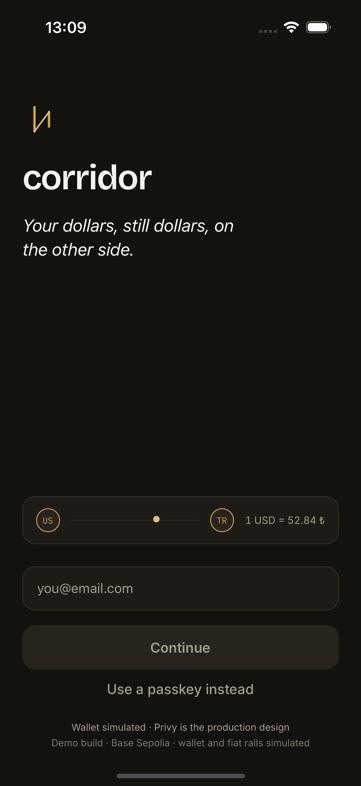
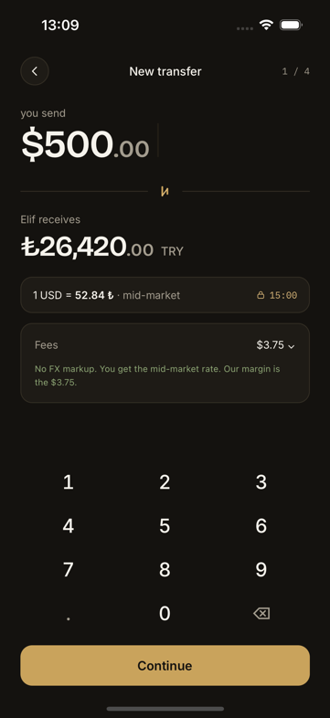
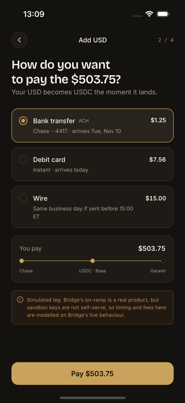
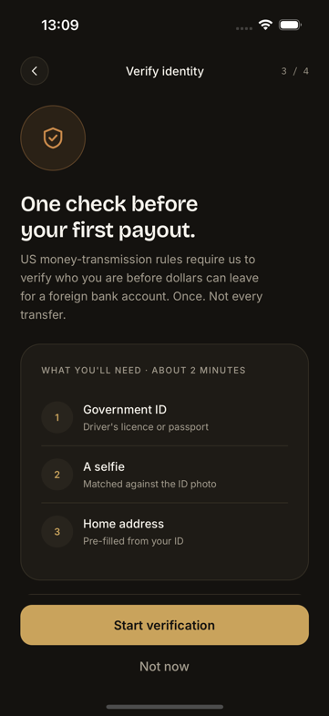
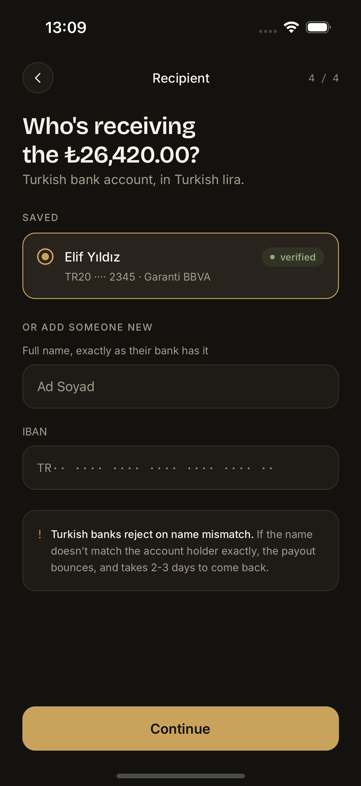
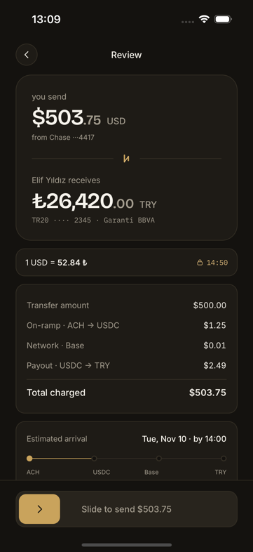
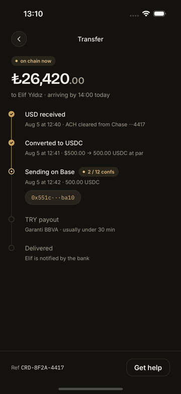
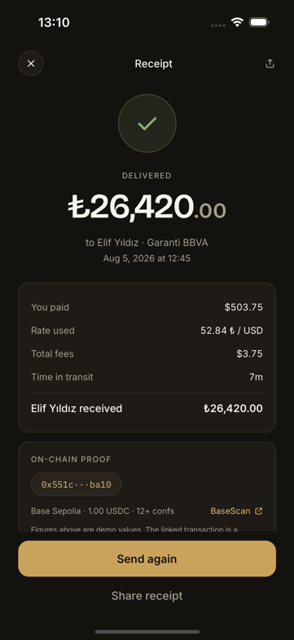
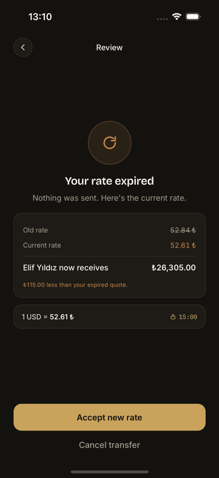
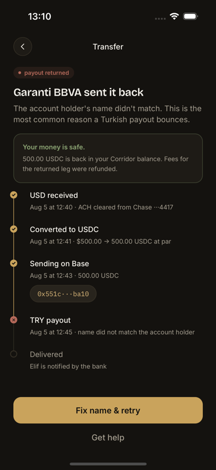

# Corridor

[](https://github.com/ihsanktmr/corridor/actions/workflows/ci.yml)

A stablecoin remittance case study: **USD → USDC → TRY payout**, built to demonstrate product design and integration architecture for consumer fintech.

<p align="center">
  
  
  
  
  
</p>
<p align="center">
  
  
  
  
  
</p>

<p align="center">
  <sub>Welcome · Amount · Add USD · KYC gate · Recipient, then Review · In flight · Receipt · Rate expired · Payout returned<br>
  iPhone 16, Expo Go. Every figure on screen is computed by the domain layer, not mocked into the view.</sub>
</p>

One corridor, one flow: on-ramp → KYC gate → USDC send → Turkish lira payout. Türkiye wasn't picked as a generic demo pair. It's a genuine high-inflation, high-stablecoin-adoption market, which is what makes the corridor worth designing.

**No money moves here.** See [What's real](#whats-real) before reading anything else.

**[Try it in your browser →](https://ihsanktmr.github.io/corridor/demo/)** The whole flow, every rail simulated and labelled as such.

**[Watch the 36-second walkthrough →](docs/corridor-walkthrough.mp4)** Quote, identity, settlement, receipt, and returned-payout recovery.

---

## The documents

| | |
|---|---|
| [**Brand identity**](https://ihsanktmr.github.io/corridor/corridor-identity.html) | Palette, type, tokens, motion signature |
| [**UI/UX screens**](https://ihsanktmr.github.io/corridor/corridor-screens.html) | 13 captured states, component library, per-screen design and architecture notes |
| [**Integration architecture**](https://ihsanktmr.github.io/corridor/corridor-architecture.html) | Provider audit, trust boundary, contracts, transfer state machine |
| [**Architecture diagram**](https://ihsanktmr.github.io/corridor/corridor-diagram.html) | System and settlement timeline, one page |
| [**Failure modes**](https://ihsanktmr.github.io/corridor/corridor-failure-modes.html) | Full failure register, settlement-risk analysis, known gaps |
| [**Market and product-pattern notes**](docs/market-notes.md) | Sourced comparison of rate, fee, tracking, and proof patterns |
| [**Usability validation plan**](docs/usability-test-plan.md) | Five-session protocol, comprehension thresholds, observation log; no invented findings |

If you only read one, read the failure modes.

---

## What's real

Four of the five rails are simulated, and every one is disclosed **on-screen** at the moment it matters. The badge text is read from the provider registry rather than written into the screens, so a screen can't claim a leg is real while a fixture is bound.

| Rail | Status | Why |
|---|---|---|
| Domain logic (money, rates, IBAN, state) | **Real** | `bigint` minor units, rational rates, ISO 7064 mod-97. 51 tests. |
| Design system | **Real** | Ported from the identity spec, unchanged |
| Settlement contract call | **Real, once, by script** | One 1.00 USDC transfer on Base Sepolia, signed by [`scripts/proof.mts`](scripts/proof.mts), not by the app. See [below](#the-proof-artifact) |
| Wallet | Simulated | The app holds no key and can't sign: every transfer shows the proof script's hash. Privy is the production design, but `@privy-io/expo` needs native modules → a dev build → you couldn't `npx expo start` this |
| Backend | Simulated | The Corridor API runs in-process ([`services/corridor.ts`](services/corridor.ts)) behind the same contracts. Quote signing is keyed FNV-1a standing in for HMAC-SHA256 |
| USD on-ramp | Simulated | Real Bridge product, but sandbox keys are **not self-serve** |
| TRY payout | Simulated | **Bridge has no TRY route in either direction.** Not a gate, the product isn't sold |
| Identity verification | Real flow, fixture verdict | Sequencing and retry are production-shaped; no documents are captured |

### The proof artifact

The case study's central evidentiary claim is that the settlement contract call is real. `scripts/proof.mts` discharges it outside the app: a genuine ERC-20 transfer on Base Sepolia, signed locally in Node with `viem`, verifiable by anyone on BaseScan without taking this repo's word for anything. The app itself doesn't sign; its wallet is simulated.

```bash
npm run proof              # status + funding needed
npm run proof -- --send    # sign and broadcast
```

The chain is hard-coded and there is no flag to change it. Keys are generated into `.env` (gitignored) and never printed. A successful run writes `proof-artifact.json` with the hash, block number and explorer link.

### ✓ Broadcast and verifiable

```
0x551c67045ddfe8e8fb94fdad1ca0b5ffd078d3ca50f167531f0680722a55ba10
```

**[Verify it on BaseScan →](https://sepolia.basescan.org/tx/0x551c67045ddfe8e8fb94fdad1ca0b5ffd078d3ca50f167531f0680722a55ba10)**

| | |
|---|---|
| Status | `success`, block 45038683 |
| Contract | `0x036CbD53842c5426634e7929541eC2318f3dCF7e` (Circle's canonical Base Sepolia USDC) |
| Transfer | 1.00 USDC → treasury, 57,359 gas |

Full record in [`proof-artifact.json`](proof-artifact.json). Every receipt in the app links to this one transaction on BaseScan.

**On the amount.** The demo figures throughout the app are 500.00 USDC; the on-chain transaction is **1.00 USDC**, capped by Circle's testnet faucet. Same contract and decimals. It was signed by `scripts/proof.mts`, not the app, whose wallet is simulated. The receipt screen says so on the screen itself, not just here. A receipt implying a 500.00 settlement over a 1.00 transaction would be exactly the kind of thing this project exists to argue against.

---

## Running it

```bash
npm install
npm start          # then press i for the iOS simulator
```

Runs in Expo Go, no dev build, no native compilation, no credentials. Every rail is simulated by default, so it works offline.

**Jump straight to a screen.** The interesting states sit three or four steps into a flow that takes real time to walk, so each has a deep link:

```
corridor://demo/review      corridor://demo/inflight    corridor://demo/receipt
corridor://demo/expired     corridor://demo/returned    corridor://demo/kyc-resubmit
```

These build the same event log the real timeline produces. No screen special-cases them. They work on the hosted demo too, for example [`/demo/demo/receipt`](https://ihsanktmr.github.io/corridor/demo/demo/receipt) or [`/demo/demo/returned`](https://ihsanktmr.github.io/corridor/demo/demo/returned).

```bash
npm test           # 51 tests: domain, rail selection, plus the full flow end to end
npm run typecheck  # strict + noUncheckedIndexedAccess + exactOptionalPropertyTypes
```

**Regenerate the evidence.** With Metro running on an iPhone 16 simulator and
[Maestro](https://maestro.mobile.dev/) installed, the checked-in flow walks the
product and captures all thirteen states instead of relying on hand-picked images:

```bash
maestro test -e METRO_URL=exp://127.0.0.1:8081 \
  --test-output-dir /tmp/corridor-screens .maestro/capture-screens.yaml
```

The shorter `.maestro/walkthrough.yaml` drives the checked-in 36-second portfolio video.

**It also runs in a browser:** `npm run web`. The wallet is behind the provider seam, so the build has no native-only dependency; a real Privy adapter would change that, since Privy's Expo SDK has no web target.

---

## Layout

```
domain/       money · rate · iban · quote · transfer   ← the part worth reading
providers/    contracts · registry · simulated adapters
services/     corridor (the in-process API) · signing
theme/        tokens ported from the identity spec
components/   primitives from the phase 2 library
app/          expo-router file routes, the 11 screens
```

### Three decisions that shaped the rest

**Money is never a number.** Minor units as `bigint`, currency-tagged, rates as rationals. The dangerous boundary is USD→USDC (2 decimals against 6, a factor of 10⁴), and `rescale()` refuses to scale down lossily rather than truncating, because silently dropping sub-cent remainders is how a ledger stops balancing.

**Payout is a binding, not a call.** `USD:TRY` and `USD:MXN` differ by one row in `ROUTES`. Bridge covers MXN via SPEI and doesn't cover TRY at all. Discovering that during integration is exactly what the seam is for. `bridge.mxn.spei` is implemented and never called so the abstraction can be seen to be real rather than retrofitted.

**State is a fold over an append-only log.** Three providers with three clocks deliver events late, twice, and out of order. `seq` is assigned on ingress and duplicates are dropped by event identity, not by `seq`, since a vendor retry arrives with a fresh one. Both the state and each step only move forward, so a late webhook can never walk a delivered transfer backwards on screen. Covered by tests.

---

## Status

Phases 1-5 complete: identity → design system → integration architecture → build → packaging.

Typecheck clean, 51/51 tests, iOS bundle succeeds.

Web export ships only the seven font faces the UI uses: 25 assets and 2.8 MB, down from 57 assets and 9.8 MB before deep imports.

Reduced Motion disables decorative loops and native screen transitions. Large display figures and fixed-height controls use bounded Dynamic Type scaling while body copy remains free to reflow in scrollable content.

Brand faces (Bricolage Grotesque, Inter, IBM Plex Mono) are bundled via `expo-font` and held behind the splash until loaded.

**All thirteen captured states are verified on an iPhone 16 simulator.** Every image above is that build; Home, ID capture, and KYC resubmit are also in [`docs/screens/`](docs/screens). The checked-in Maestro flow is the source of truth for regenerating them.

## Licence

MIT, see [LICENSE](LICENSE).
